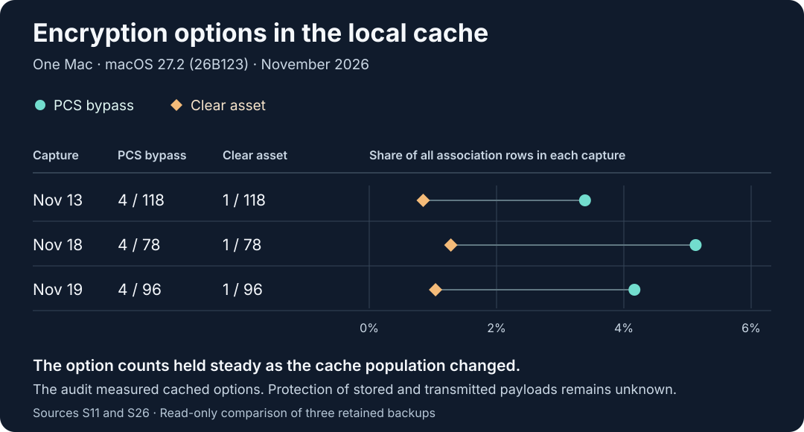

# CloudKit Reverse Engineering

This investigation follows CloudKit metadata on one Mac running macOS 27.2 build `26B123`. Three snapshots from November 13, 18, and 19, 2026 show how the cache changed. A fresh installation of the same build on a virtual machine (VM) provides a signed-out comparison. **Developer-related settings were enabled on the Mac. The retained evidence does not establish that a developer changed them or the user’s CloudKit account.**

## Two unusual entries in the local cache

| Installation and checkpoint | Cached app identity rows | APNs value `serverPreferred` | VFS `open-by-id` set to Boolean true |
| --- | ---: | ---: | ---: |
| Original Mac · Nov 13 | 101 | 57 | 27 |
| Original Mac · Nov 18 | 68 | 35 | 7 |
| Original Mac · Nov 19 | 86 | 52 | 24 |
| Reference VM · before skipping Apple Account sign-in | 10 | 3 | 0 |
| Reference VM · after skipping sign-in | 10 | 3 | 0 |
| Reference VM · first signed-out desktop | 42 | 23 | 0 |
| Reference VM · after shutdown | 43 | 23 | 0 |

Each cell counts rows in the same snapshot’s `AppBundle.entitlements` field. A service can have several logical identities, and one row can match both columns. The four guest checkpoints belong to one installation on the same physical Mac. Its account and feature history differed from the original’s. [S11, S12, S20, S26]

**`serverPreferred` appeared before sign-in.** The cached key is `com.apple.developer.aps-environment`. On November 13, 77 of the 101 app rows had this key. The exact values were `serverPreferred` (57), `production` (14), `Production` (5), and `development` (1). The signature checks also found `serverPreferred` in Apple-signed `bird` and `voicebankingd`. In one Home service comparison, signed `homed` carried the value under the shorter `aps-environment` spelling. Apple documents development and production for push registration and explains how Xcode uses a provisioning profile. It gives no selection rule for `serverPreferred`, and the cache records no endpoint choice for an individual registration. [S11, S12, S20] [Apple’s macOS APNs entitlement](https://developer.apple.com/documentation/bundleresources/entitlements/com.apple.developer.aps-environment)

**The virtual filesystem (VFS) entitlement appeared only on the original installation.** Of the 27 original matches on November 13, 26 were logical `com.apple.bird` identities and one was `com.apple.CloudDocs.iCloudDriveFileProvider`. The later splits were 6 + 1 and 23 + 1. Both installed iCloud Drive executables passed strict signature verification against Apple’s signing anchor and carried `com.apple.private.vfs.open-by-id=true`. Apple’s published XNU source checks platform-binary status or this entitlement when opening a file by filesystem and object ID. That explains the capability. The audit has no event identifying a file opened this way, and the different cache populations leave the reason for the guest’s zero count open. The evidence supplies no link to a local CloudKit server or a choice of SQLite’s separately named VFS storage interface. [S21, S26] [Apple’s XNU source](https://github.com/apple-oss-distributions/xnu/blob/f6217f891ac0bb64f3d375211650a4c1ff8ca1ea/bsd/vfs/vfs_syscalls.c#L5437-L5492) · [SQLite’s VFS definition](https://www.sqlite.org/vfs.html)

## Did someone with developer privileges change this system?

**No reviewed artifact shows that a developer changed the observed CloudKit settings on the original Mac or its user’s CloudKit account.** A separate November 14 audit of the same startup volume group did record developer-related settings enabled on the Mac. The evidence for how each setting got there differs.

| Evidence | What it establishes |
| --- | --- |
| Mac security policy · Nov 14 | Apple Mobile File Integrity (AMFI) reported `developer_mode_status=1` and `developer_mode_resolved=1`. The observed boot inputs matched a path in the inspected release firmware that selects the enabled state automatically, without a user setting. The audit could not verify that the running firmware was byte-identical to the inspected image. [S27] |
| Developer tools authorization · Nov 14 | `DevToolsSecurity` separately reported **enabled** for Apple’s debugging and performance tools. The audit found no event showing when it was enabled, what set it, or who acted. This setting concerns local tools. [S27] |
| Apple-shipped service configuration | `homeeventsd` and `businessservicesd` carried the iCloud-container value `Development` in the two earlier captures. The signature survey confirmed it on both Apple executables. Separately, signed `imagent` carried APNs `development` alongside iCloud-container `Production`. These values belong to the individual services. [S11, S20] |
| Local environment labels | All server-info rows said `Production` on Nov 13, 18, and 19 (73/73, 54/54, 55/55). All push-token environment rows said `production` (97/97, 49/49, 70/70). These fields measure cached container configuration and push registration respectively. None records a switch of the user’s account environment. [S11, S26] |
| App provisioning and cache population | A provisioning profile can determine an app’s signed APNs setting. A signed-out guest populated `serverPreferred` on its own setup path. Neither observation identifies a local provisioning change, its operator, or a manual cache edit. [S12, S20] |
| The project’s own helper | On Nov 19 the researchers deliberately configured and ad hoc signed a local test helper. Its test stopped at acquisition-creator validation. This attributes the helper configuration to the experiment at project level. It supplies no evidence of an alteration to an Apple service binary or a CloudKit account. [S16] |
| Remote administration | A team query lacked a management token and the audit had no developer access to the relevant remote resources. No reviewed deployment or account record identifies an action, affected resource, time, and responsible credential. The prior remote history therefore remains unknown. [S8] |

A production schema deployment requires permission to edit the production environment. A deployment receipt or audit event naming the container, action, time, and team or credential would support a specific claim. Identifying an individual would additionally require evidence of who used that credential. [Apple’s schema deployment guide](https://developer.apple.com/documentation/cloudkit/deploying-an-icloud-container-s-schema) · [iCloud container environment](https://developer.apple.com/documentation/bundleresources/entitlements/com.apple.developer.icloud-container-environment)

## The findings that deserve attention

| Question | What was observed | What remains open |
| --- | --- | --- |
| Why is one private entitlement stored as text? | One `com.apple.security.kcsharing` identity row carried `com.apple.private.cloudkit.masquerade` as the string `"true"` in two earlier snapshots; the November 19 cache also had one string-valued row. A traced Apple compatibility path can create this representation. | The exact historical writer and branch have not been identified. A fresh signed-out reference had no matching identity row, so it cannot establish whether the type is normal for a populated shared-keychain identity. |
| Why do encryption-related options say “bypass” and “clear”? | The Nov 13, 18, and 19 caches each had four account-association rows with `bypassPCSEncryption=true` and one with `useClearAssetEncryption=true`, out of 118, 78, and 96 associations respectively. [S11, S26] | These fields concern specific paths and layers. The investigation did not measure the resulting stored content, wire bytes, or every protection, and did not establish unauthorized access or a TLS downgrade. |
| What happened in the Buddy comparison? | After Mac setup, the local daemon returned a preliminary response in both test conditions. The research helper lacked the signed Buddy entitlement. | The experiment stopped at that response. It acquired zero sessions and requested no iCloud data. Access during setup remains untested. [S16] |
| Why did local services report errors? | One five-minute audit window contained 11 account-info cache-write failures, 10 account-store connection/lookup errors, and 50 push-registration error messages in one 517-microsecond burst. | Causes and user-visible effects were not established. Fifty messages are not necessarily 50 network requests or retries. Later status responses reported CKKS and Octagon ready. |
| Did the local cache change? | Across November 13, 18, and 19 snapshots, local metadata rows were 394, 254, and 312. Three November 16 database-open failures preceded a new database-family birth time. | These facts are consistent with a cache recreation episode; they do not identify its cause, writer, or an unauthorized edit. The counts are local snapshots, not remote records. |

### Other findings with measured counts

| Observation on the original Mac | Nov 13 | Nov 18 | Nov 19 | What was counted |
| --- | ---: | ---: | ---: | --- |
| HTTP response-header capture preference | 31/118 | 6/78 | 23/96 | Association rows with the option set to true. The audit has no resulting header capture. |
| Anonymous share-participant preference | 4/118 | 0/78 | 0/96 | Association rows with the option set to true. The cache alone cannot identify a recipient. |
| Preference to hide the sharing-options interface | 3/118 | 3/78 | 3/96 | Association rows with the option set to true. An actual share or user-interface event was unobserved. |
| `customAccounts` | 34 | 14 | — | Rows mentioning the named term. At signed-out guest desktop and shutdown, four rows each carried the Boolean entitlement. |
| `DigitalHealth` | 3 | 1 | — | Rows mentioning the term. Each earlier subject capture and the signed-out guest at desktop and shutdown contained one exact service mapping for encrypted remote management. |

The first three rows use the full association table at each date as their denominator. All five Nov 13 associations with an exceptional encryption option had these three preferences set to false. The last two rows use a separate eight-table search. A dash marks a capture outside that search. [S11, S12, S22, S26]

On Nov 13, 21 of 118 associations lacked a matching push-token row and 12 lacked a matching server-info row. These are gaps in the local cache. The full inventory gives counts for Bluetooth pairing, EnergyKit, Home monitoring, the test push topic, FedStats, and unresolved app ownership. It also documents which early interpretations changed when checked against signed software or later guest measurements. [S20, S22, S23, S25] [Full findings inventory](research/anomaly-inventory.md) · [Evidence index](research/evidence-and-methods.md#source-index)

## What was actually measured

On November 19 the main audit examined one arm64 Mac using a consistent SQLite backup and bounded local diagnostics. It classified **241 primary operations**, recorded **836 native invocations**, and sealed **2,688 artifacts** totaling approximately **148.7 MB** in an unsigned local SHA-256 manifest. The artifact hashes were rechecked against that manifest; the manifest is not independent proof of an untampered acquisition. [S1, S9]

| Local observation | Result | Meaning |
| --- | ---: | --- |
| Metadata cache | 8 tables; 312 rows | Client metadata, not a complete remote inventory. |
| Cached identities | 86 identity rows; 58 distinct base identifiers | Rows are not necessarily unique processes or accounts. |
| Cached containers | 70 distinct identifiers | Identifiers present in this local cache, not all remote containers. |
| Owner mapping | 46 of 58 base identifiers mapped to verified current owners; 12 unresolved | Forty-five of the 46 had an explicit signed application-identifier binding. An unresolved owner is an evidence gap. |
| Signature checks | 48 mapped owner executables passed Apple-anchor verification; 8 initially selected component checks also passed | The two sets overlap. Entitlement extraction is a different operation. |
| Application survey | 563 bundles discovered; 556 entitlement extractions succeeded; 7 failed; 87 successful extractions matched CloudKit/iCloud-related entitlements | Matching a capability does not show that an app used it. |
| Keychain status | 23 of 23 CKKS views reported ready; Octagon reported `Ready` | Twenty-one views reported managed sync and initial sync finished; two were non-managed and reported initial sync not finished. This is not an end-to-end sync test. |
| Selected logs | 13,856 records in five minutes, including 97 Error and 1 Fault | Log entries are not necessarily independent incidents. |
| Remote administration | Management token unavailable; user reported no developer access | Remote teams, schemas, zones, shares, records, and metrics were not enumerated. |

These are observations from the original collection, not claims about today's machine or account. [S1, S4, S5, S8]

## The `masquerade` string: suspicious-looking is not the same as explained

The name is striking. The underlying detail is more precise: the November 19 cache held **59 Boolean `true` values**, **one string `"true"`**, and **26 rows with the key absent** across 86 cached identity rows. Earlier captures of the same host had **67 / 1 / 33** and **41 / 1 / 26**, respectively. In those earlier captures, the string belonged to `com.apple.security.kcsharing`. [S1, S6, S11]

The build-specific trace found a plausible Apple implementation route. Signed `secd` carries `com.apple.private.cloudcoreinternal.allow-custom-bundle-ids`; a CloudKit compatibility overlay can build a `[String: String]` dictionary containing the older `com.apple.private.cloudkit.masquerade` key, which JSON then preserves as text. This is substantive evidence against assuming that quotes alone prove a manual edit. It is not a record of the particular historical transaction. [S11]

### The reference system changes the question

A fresh installation of the **same build**, in a VM with a new identity and blank disk on the same physical Mac, was measured while signed out. Four checkpoints had 10, 10, 42, and 43 cached app rows; none had the exact `kcsharing` row or a string-valued `masquerade` entry. The original system had the row. The guest and original differed in account state and feature history, so this is a real comparison but **not a like-for-like test of the populated row**. [S12]

| Capture | Cached app rows | Exact `kcsharing` row | String `"true"` rows | Boolean `true` rows |
| --- | ---: | ---: | ---: | ---: |
| Fresh signed-out guest, checkpoint 1 | 10 | 0 | 0 | 5 |
| Fresh signed-out guest, checkpoint 2 | 10 | 0 | 0 | 5 |
| Fresh signed-out guest, desktop | 42 | 0 | 0 | 22 |
| Fresh signed-out guest, after shutdown | 43 | 0 | 0 | 23 |
| Original Mac, earlier capture | 101 | 1 | 1 | 67 |
| Original Mac, later capture | 68 | 1 | 1 | 41 |

These are four observations of **one** guest installation and two observations of **one** original installation, not six independent devices. The number of independent comparable installations with a measured `kcsharing` row remains zero. The right follow-up is a separately authorized, comparable shared-keychain workload and a writer-correlated trace—not a claim that this representation is proven rare or malicious. [S11, S12]

## Encryption-related options: names, paths, and limits

The three snapshots each contained **four account-association rows with `bypassPCSEncryption=true`** and **one with `useClearAssetEncryption=true`**. These values are persisted options. Whether a service used one for a particular record or asset is a separate question. [S11, S26]

Build-specific analysis found that Apple software uses these options for particular operations. Published Apple Security source independently corroborates that its own services can request the PCS option. The local snapshots record configuration. No captured operation connects a row to the bytes of an asset in storage or in transit. The observations therefore leave the account’s effective protections unresolved. [S13, S14, S15]

## The Buddy-access test

“Buddy” refers to device setup. In a November 19 comparison after setup had finished, the local daemon returned an acquisition creator in both tested conditions. A creator is a preliminary response in session setup. The experiment stopped there, with zero sessions acquired and zero iCloud data requests. A separate inspection found further device-readiness checks. The audit could not link the observed responses to a completed authorization decision or establish what would happen before setup. [S16, S18]

The supporting note gives the encryption counts, the Buddy comparison, and the November 21 check of three installed software images against the earlier traces. [Evidence note and build check](research/encryption-and-buddy.md)

## Errors, status, and cache history

During the five-minute November 19 window, the selected log export contained **13,856 records**: 6,632 Default, 4,646 Info, 891 Debug, 97 Error, 1 Fault, and 1,589 without a message type. Among the operational findings: [S5]

- **11 account-info cache-write failures** included missing-path and permission-related messages across nine named processes, including `secd`, `homed`, `transparencyd`, `suggestd`, and `CommCenter`. A later targeted check found ten exact paths absent and nine nearest existing parents user-owned with mode `0755`; that later state did not establish the historical sandbox or cause.
- **10 account-store connection or lookup errors** did not by themselves establish a process crash or data loss.
- **50 `cloudd` push-registration error messages** appeared in one burst spanning **517 microseconds**. No sufficient reason or code established whether these corresponded to network requests, retries, server rejection, or an ongoing problem.
- The November 18 selected 15-minute window had **100,767 log records** and **203 Error** entries. Its predicate and duration differ from the November 19 window; raw totals cannot be compared as a rate or trend. [S17]

Three database-open failures were logged on November 16 before a later database-family birth time. Together with retained file identities, they support a cache recreation hypothesis. They do not identify who or what caused it. Two same-host read-only snapshots later matched the current table counts and configuration blob, but they are not independent clean-install baselines. [S1, S6, S17]

## What appeared even on a fresh signed-out system

At the fresh guest desktop and after shutdown, **23 app rows** carried `com.apple.developer.aps-environment = serverPreferred`, **9** carried `buddyAccess = true`, and **4** carried `customAccounts = true`; one row mapped an encrypted remote-management identifier to `DigitalHealth`. The guest and original captures shared the same **12,617-byte** global policy payload, with **404 terminal entries** (401 scalar values and three empty containers). [S12]

These names merit inspection, but the comparison is a useful counterweight: their presence in cached capability metadata on a signed-out installation does not itself establish an account, feature usage, recording, monitoring, or remote activity. Counts may overlap across categories and describe only the inspected snapshots.

## Configuration is not a packet capture

The November 19 configuration inspection found **279 HTTP(S) URL occurrences**, all HTTPS, across **five hostnames**. The occurrences are configuration fields and may repeat; they are not unique requests or connections. [S3, S10]

| Configured hostname | Occurrences |
| --- | ---: |
| `gateway.icloud.com` | 221 |
| `metrics.icloud.com` | 55 |
| `gateway-china.icloud.com` | 1 |
| `media.icloud-content.com` | 1 |
| `static.gc.apple.com` | 1 |

Apple's [enterprise network reference](https://support.apple.com/en-us/101555) documents the relevant service-domain families. An earlier narrow suffix heuristic incorrectly flagged one Apple domain and was corrected. A China-named configured host alone does not establish that it was used or where data was stored. Socket checks had partial or empty results, so the research cannot prove the absence of traffic or interception either. [S1, S10]

## Explore the evidence

- [Full anomaly inventory and counting methods](research/anomaly-inventory.md)
- [Detailed November 19 findings](research/findings.md)
- [Encryption decisions and Buddy readiness](research/encryption-and-buddy.md)
- [Evidence index, acquisition methods, and redaction](research/evidence-and-methods.md)
- [Open questions and proposed research](research/open-questions.md)
- [Chart data and definitions](visuals/data.md), including the [owner-mapping chart](visuals/owner-mapping.svg)
- [Apple's CloudKit design guide](https://developer.apple.com/icloud/cloudkit/designing/) and [database reference](https://developer.apple.com/documentation/cloudkit/ckdatabase)

## What is public—and what is not

The repository preserves technical names, option values, counts, and contrary evidence. It excludes credentials, account and device identifiers, token values, raw database rows and logs, private local paths, and detailed event timestamps. Even aggregate data can be correlatable: someone who already has the same logs could recognize the combination of build and distinctive burst. The source index identifies retained private artifacts, but outside readers cannot independently reproduce all findings without access to them.

**Research questions are not accusations.** The available evidence justifies examining the unusual string representation, encryption-option paths, daemon-validation boundary, and operational errors. It does not justify declaring an unknown writer, a compromised account, a cross-device pattern, or a remote-cloud state without the missing evidence.
