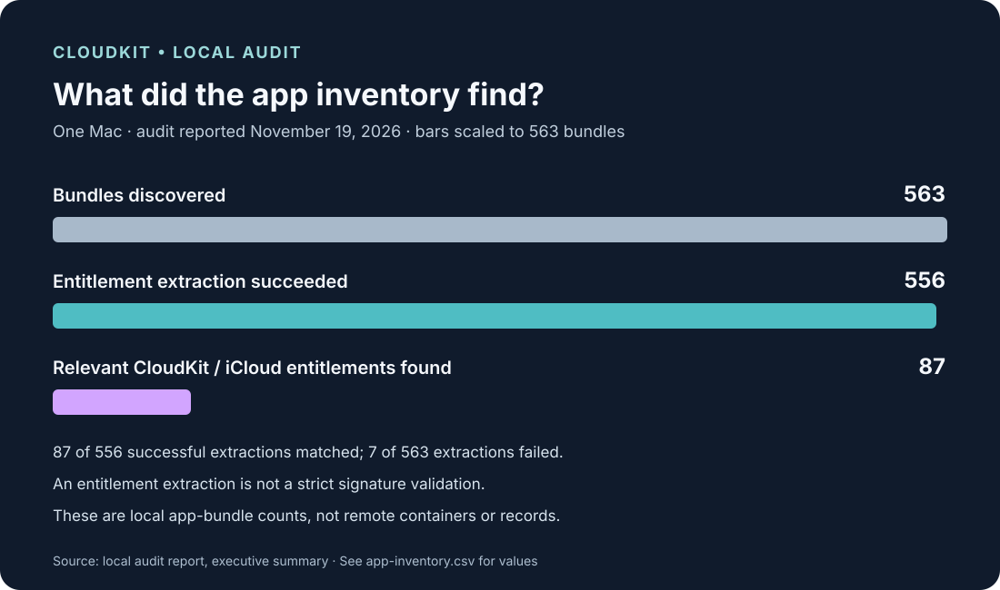

# CloudKit Reverse Engineering

A public, evidence-led study of CloudKit-related state on one macOS host: local caches, Apple service ownership, configuration, diagnostics, and the limits of what those observations can tell us.

> **Scope:** This is a local observational audit collected on November 19, 2026. Remote CloudKit teams, schemas, databases, zones, records, shares, and metrics were **not enumerated**. The evidence did not establish account compromise or a vulnerability. Local cache and log counts are not cloud-wide inventory or traffic counts.

## What the research found

| Question | Observed result | Interpretation and boundary |
| --- | --- | --- |
| What was in the local metadata cache? | 8 tables and 312 rows, including 86 cached identity rows representing 58 base identifiers and 70 distinct cached container identifiers. | This describes a local cache, not the full set of remote resources. |
| Who owned the cached identities? | 46 of 58 base identifiers mapped to verified current owners; 12 remained unresolved. | Unresolved is a coverage gap, not evidence of an untrusted owner. Forty-five mappings had explicit signed application-identifier binding. |
| How broad was the app entitlement survey? | 563 app bundles discovered; 556 extractions succeeded, 7 failed, and 87 had matching CloudKit/iCloud-related entitlements. | A matching entitlement does not prove that the app used CloudKit, and extraction alone is not signature verification. |
| Was keychain sync ready? | All 23 CKKS views reported ready; Octagon reported Ready. | These are point-in-time status reports, not an end-to-end or cross-device sync test. |
| Were logs free of errors? | A selected five-minute window contained 13,856 records, including 97 Error and 1 Fault; other targeted error patterns are explained in the findings. | Records describe diagnostic output in one window, not proven incidents or distinct failed network requests. |
| What happened in remote administration? | A management token and developer access were unavailable. | Remote resources could not be inspected. Their absence from this study says nothing about whether they exist. |

The inspected host ran macOS 27.2 (26B123), on arm64. The audit's observations are specific to that host, software build, time, and collection methods. See [the detailed findings](research/findings.md) and [evidence and methods](research/evidence-and-methods.md).

## Explore the data

The charts are generated from aggregate observations, not raw records. Each figure names its population and limitations; associated tables supply accessible values and context.

- [Local metadata cache rows](visuals/cache-tables.svg) — rows by table in the consistent local SQLite backup.
- [Entitlement survey](visuals/app-inventory.svg) — survey outcomes, with relevant matches shown within successful extractions.
- [Cached identity owner mapping](visuals/owner-mapping.svg) — verified and unresolved base identifiers.
- [What the audit could and could not see](visuals/coverage-boundary.svg) — a conceptual diagram of the evidence boundary.
- [Chart data and definitions](visuals/data.md) — the values, units, and caveats behind the figures.

For technical depth, start with [findings](research/findings.md). The [evidence and methods](research/evidence-and-methods.md) describes provenance, redaction, and reproducibility limits. [Open questions](research/open-questions.md) distinguishes productive follow-up from conclusions the current evidence cannot support.

## Reading guide

CloudKit organizes data into containers, with public, private, and shared database scopes; Apple describes the model in its [CloudKit design documentation](https://developer.apple.com/icloud/cloudkit/designing/). The local metadata cache studied here is client-side evidence and should not be confused with any of those remote database scopes. Apple's [CKDatabase reference](https://developer.apple.com/documentation/cloudkit/ckdatabase) describes the respective access models.

The original evidence is retained privately because raw diagnostics and database rows can include account identifiers, push tokens, local paths, or other personal information. The publication preserves useful aggregate values and technical explanations; it is not an independently reproducible full raw-data release. The source index identifies the retained artifacts without exposing the private location.
