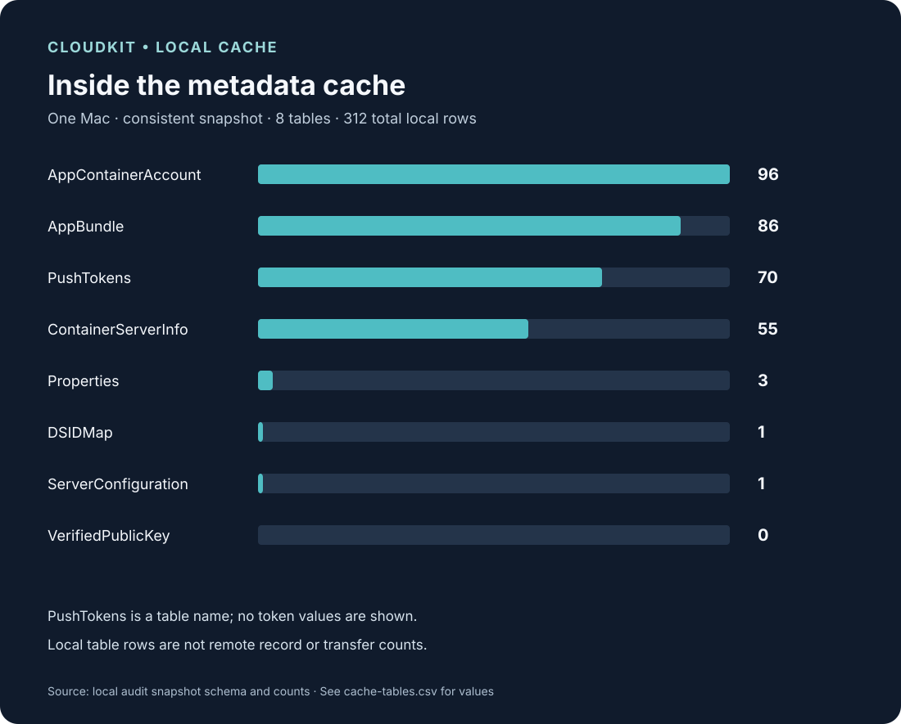
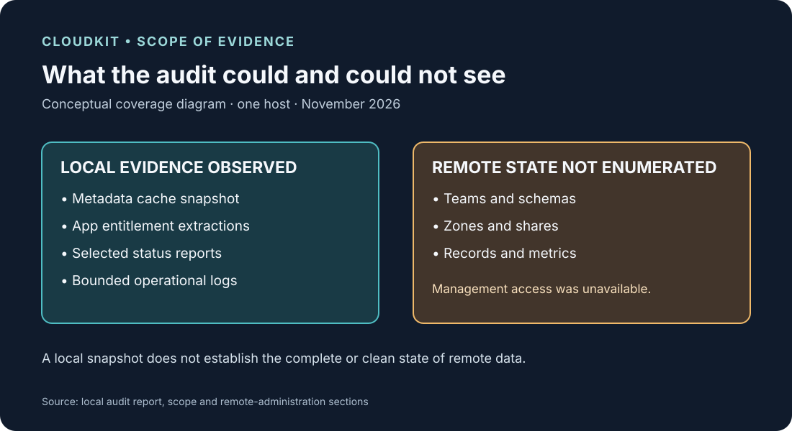

# CloudKit Reverse Engineering

**An investigation of what CloudKit leaves behind, what its private configuration says, and where the evidence stops.** This project combines a local audit, historical cache comparisons, a fresh signed-out macOS reference installation, installed-code analysis, and a separate daemon-validation experiment. It retains specific names, counts, options, and contrary evidence so readers can examine the questions for themselves.

> **State of the evidence:** The principal observations were collected November 13–19, 2026 on macOS 27.2 build `26B123`. They are historical, build-specific observations—not a live assessment. The audit did not enumerate remote CloudKit records or establish compromise, an authorization bypass, or a vulnerability. Several findings are genuinely unexpected or warrant investigation; their prevalence across comparable installations is not established.

## The findings that deserve attention

| Question | What was observed | What remains open |
| --- | --- | --- |
| Why is one private entitlement stored as text? | One `com.apple.security.kcsharing` identity row carried `com.apple.private.cloudkit.masquerade` as the string `"true"` in two earlier snapshots; the November 19 cache also had one string-valued row. A traced Apple compatibility path can create this representation. | The exact historical writer and branch have not been identified. A fresh signed-out reference had no matching identity row, so it cannot establish whether the type is normal for a populated shared-keychain identity. |
| Why do encryption-related options say “bypass” and “clear”? | Two earlier caches each had four account-association rows with `bypassPCSEncryption=true` and one with `useClearAssetEncryption=true`. Installed-code analysis identified specific setter and consumer paths. | These fields concern specific paths and layers. The investigation did not measure the resulting stored content, wire bytes, or every protection, and did not establish unauthorized access or a TLS downgrade. |
| Can a client ask for Buddy access without the private entitlement? | In a separate test, an unsandboxed ad hoc helper lacking `com.apple.private.cloudkit.buddyAccess` received a daemon acquisition creator with the new flag both false and true. | The test stopped before acquiring a session, ran after setup, and requested no iCloud data. It did not prove access during setup or a usable unauthorized session. |
| Why did local services report errors? | One five-minute audit window contained 11 account-info cache-write failures, 10 account-store connection/lookup errors, and 50 push-registration error messages in one 517-microsecond burst. | Causes and user-visible effects were not established. Fifty messages are not necessarily 50 network requests or retries. Later status responses reported CKKS and Octagon ready. |
| Did the local cache change? | Across November 13, 18, and 19 snapshots, local metadata rows were 394, 254, and 312. Three November 16 database-open failures preceded a new database-family birth time. | These facts are consistent with a cache recreation episode; they do not identify its cause, writer, or an unauthorized edit. The counts are local snapshots, not remote records. |

The table is a map of the investigation, not a verdict. The [evidence index](research/evidence-and-methods.md#source-index) identifies the retained source reports and distinguishes public references from private source material.

## What was actually measured

On November 19 the main audit examined one arm64 Mac using a consistent SQLite backup and bounded local diagnostics. It classified **241 primary operations**, recorded **836 native invocations**, and sealed **2,688 artifacts** totaling approximately **148.7 MB** in an unsigned local SHA-256 manifest. The artifact hashes were rechecked against that manifest; the manifest is not independent proof of an untampered acquisition. [S1, S9]

| Local observation | Result | Meaning |
| --- | ---: | --- |
| Metadata cache | 8 tables; 312 rows | Client metadata, not a complete remote inventory. |
| Cached identities | 86 identity rows; 58 distinct base identifiers | Rows are not necessarily unique processes or accounts. |
| Cached containers | 70 distinct identifiers | Identifiers present in this local cache, not all remote containers. |
| Owner mapping | 46 of 58 base identifiers mapped to verified current owners; 12 unresolved | Forty-five of the 46 had an explicit signed application-identifier binding. An unresolved owner is an evidence gap. |
| Signature checks | 48 mapped owner executables passed Apple-anchor verification; 8 initially selected component checks also passed | The two sets overlap. Entitlement extraction is a different operation. |
| Application survey | 563 bundles discovered; 556 entitlement extractions succeeded; 7 failed; 87 successful extractions matched CloudKit/iCloud-related entitlements | Matching a capability does not show that an app used it. |
| Keychain status | 23 of 23 CKKS views reported ready; Octagon reported `Ready` | Twenty-one views reported managed sync and initial sync finished; two were non-managed and reported initial sync not finished. This is not an end-to-end sync test. |
| Selected logs | 13,856 records in five minutes, including 97 Error and 1 Fault | Log entries are not necessarily independent incidents. |
| Remote administration | Management token unavailable; user reported no developer access | Remote teams, schemas, zones, shares, records, and metrics were not enumerated. |

These are observations from the original collection, not claims about today's machine or account. [S1, S4, S5, S8]

## The `masquerade` string: suspicious-looking is not the same as explained

The name is striking. The underlying detail is more precise: the November 19 cache held **59 Boolean `true` values**, **one string `"true"`**, and **26 rows with the key absent** across 86 cached identity rows. Earlier captures of the same host had **67 / 1 / 33** and **41 / 1 / 26**, respectively. In those earlier captures, the string belonged to `com.apple.security.kcsharing`. [S1, S6, S11]

The build-specific trace found a plausible Apple implementation route. Signed `secd` carries `com.apple.private.cloudcoreinternal.allow-custom-bundle-ids`; a CloudKit compatibility overlay can build a `[String: String]` dictionary containing the older `com.apple.private.cloudkit.masquerade` key, which JSON then preserves as text. This is substantive evidence against assuming that quotes alone prove a manual edit. It is not a record of the particular historical transaction. [S11]

### The reference system changes the question

A fresh installation of the **same build**, in a VM with a new identity and blank disk on the same physical Mac, was measured while signed out. Four checkpoints had 10, 10, 42, and 43 cached app rows; none had the exact `kcsharing` row or a string-valued `masquerade` entry. The original system had the row. The guest and original differed in account state and feature history, so this is a real comparison but **not a like-for-like test of the populated row**. [S12]

| Capture | Cached app rows | Exact `kcsharing` row | String `"true"` rows | Boolean `true` rows |
| --- | ---: | ---: | ---: | ---: |
| Fresh signed-out guest, checkpoint 1 | 10 | 0 | 0 | 5 |
| Fresh signed-out guest, checkpoint 2 | 10 | 0 | 0 | 5 |
| Fresh signed-out guest, desktop | 42 | 0 | 0 | 22 |
| Fresh signed-out guest, after shutdown | 43 | 0 | 0 | 23 |
| Original Mac, earlier capture | 101 | 1 | 1 | 67 |
| Original Mac, later capture | 68 | 1 | 1 | 41 |

These are four observations of **one** guest installation and two observations of **one** original installation, not six independent devices. The number of independent comparable installations with a measured `kcsharing` row remains zero. The right follow-up is a separately authorized, comparable shared-keychain workload and a writer-correlated trace—not a claim that this representation is proven rare or malicious. [S11, S12]

## Encryption-related options: names, paths, and limits

The earlier November 13 and November 18 subject snapshots each contained **four account-association rows with `bypassPCSEncryption=true`** and **one with `useClearAssetEncryption=true`**. These are actual option values in local metadata, and their names warrant scrutiny. They do not themselves describe every layer of protection or prove that a user’s data was exposed. [S11]

The investigation went beyond the names:

- On the installed build, static analysis found a CloudKit asset-repair constructor creating a generated `com.apple.cloudkit.metadata-%@` companion and setting `bypassPCSEncryption=true`. In the examined CloudKitDaemon path, a true bypass flag makes the `shouldUsePCSEncryption` decision return false. The trace is build-specific static evidence; it does not prove that this path executed for a particular historical row. [S13]
- A separate installed-code trace identified a `ProtectedCloudKeySyncing` path requesting the PCS bypass option for `com.apple.security.PCSIdentityBackup`, and a `SyncedDefaultsDaemon` path requesting a clear-asset option for a statically named `NoEncryption` store type. These are specific construction paths, not proof that all CloudKit traffic or assets are unencrypted. [S14]
- Apple's published Security source contains production code that explicitly sets the PCS bypass option in [TrustedPeersHelper](https://github.com/apple-oss-distributions/Security/blob/97c3a4296c1ea06b0fe1877a7e616aa84450b5b2/keychain/TrustedPeersHelper/TrustedPeersHelperSpecificUser.m#L103) and [OTManager](https://github.com/apple-oss-distributions/Security/blob/97c3a4296c1ea06b0fe1877a7e616aa84450b5b2/keychain/ot/OTManager.m#L3307). The inspected public source version is not identical to the installed build, and the setters do not establish every downstream protection. [S15]

**Unanswered:** which concrete data, if any, traversed these paths in this account; what bytes and cryptographic protections applied at each layer; and why each option was selected. The research did not establish plaintext network traffic, disabled TLS or Advanced Data Protection, a successful unauthorized read, or compromise.

## The Buddy-access test

A separate November 19 experiment examined the newer `system.allowAccessDuringBuddy` configuration flag. An unsandboxed ad hoc helper had a synthetic ordinary application identifier and **no signed `com.apple.private.cloudkit.buddyAccess` entitlement**. The local daemon returned a nonnil session-acquisition **creator** and no error both with the flag set to `false` and with it set to `true`. The inspected configuration validator did not read that flag. [S16]

This is an observed front-door validation result, not a complete session test. The machine had already completed setup; the experiment stopped before session acquisition and made no CloudKit data request. Pre-setup device checks, first-unlock checks, legacy entitlement gating, container authorization, and sandbox restrictions were not established by this test. An earlier raw XPC error was a transport failure, not proof of a Buddy-flag denial. The unanswered question is whether a later gate denies the scenario under the conditions that matter.

## Errors, status, and cache history

During the five-minute November 19 window, the selected log export contained **13,856 records**: 6,632 Default, 4,646 Info, 891 Debug, 97 Error, 1 Fault, and 1,589 without a message type. Among the operational findings: [S5]

- **11 account-info cache-write failures** included missing-path and permission-related messages across nine named processes, including `secd`, `homed`, `transparencyd`, `suggestd`, and `CommCenter`. A later targeted check found ten exact paths absent and nine nearest existing parents user-owned with mode `0755`; that later state did not establish the historical sandbox or cause.
- **10 account-store connection or lookup errors** did not by themselves establish a process crash or data loss.
- **50 `cloudd` push-registration error messages** appeared in one burst spanning **517 microseconds**. No sufficient reason or code established whether these corresponded to network requests, retries, server rejection, or an ongoing problem.
- The November 18 selected 15-minute window had **100,767 log records** and **203 Error** entries. Its predicate and duration differ from the November 19 window; raw totals cannot be compared as a rate or trend. [S17]

Three database-open failures were logged on November 16 before a later database-family birth time. Together with retained file identities, they support a cache recreation hypothesis. They do not identify who or what caused it. Two same-host read-only snapshots later matched the current table counts and configuration blob, but they are not independent clean-install baselines. [S1, S6, S17]

## What appeared even on a fresh signed-out system

At the fresh guest desktop and after shutdown, **23 app rows** carried `aps-environment = serverPreferred`, **9** carried `buddyAccess = true`, and **4** carried `customAccounts = true`; one row mapped an encrypted remote-management identifier to `DigitalHealth`. The guest and original captures shared the same **12,617-byte** global policy payload, including **404 typed leaf values**. [S12]

These names merit inspection, but the comparison is a useful counterweight: their presence in cached capability metadata on a signed-out installation does not itself establish an account, feature usage, recording, monitoring, or remote activity. Counts may overlap across categories and describe only the inspected snapshots.

## Configuration is not a packet capture

The November 19 configuration inspection found **279 HTTP(S) URL occurrences**, all HTTPS, across **five hostnames**. The occurrences are configuration fields and may repeat; they are not unique requests or connections. [S3, S10]

| Configured hostname | Occurrences |
| --- | ---: |
| `gateway.icloud.com` | 221 |
| `metrics.icloud.com` | 55 |
| `gateway-china.icloud.com` | 1 |
| `media.icloud-content.com` | 1 |
| `static.gc.apple.com` | 1 |

Apple's [enterprise network reference](https://support.apple.com/en-us/101555) documents the relevant service-domain families. An earlier narrow suffix heuristic incorrectly flagged one Apple domain and was corrected. A China-named configured host alone does not establish that it was used or where data was stored. Socket checks had partial or empty results, so the research cannot prove the absence of traffic or interception either. [S1, S10]

## Explore the evidence

- [Detailed November 19 findings](research/findings.md)
- [Evidence index, acquisition methods, and redaction](research/evidence-and-methods.md)
- [Open questions and proposed research](research/open-questions.md)
- [Chart data and definitions](visuals/data.md), including the [owner-mapping chart](visuals/owner-mapping.svg)
- [Apple's CloudKit design guide](https://developer.apple.com/icloud/cloudkit/designing/) and [database reference](https://developer.apple.com/documentation/cloudkit/ckdatabase)

## What is public—and what is not

The repository preserves technical names, option values, counts, and contrary evidence. It excludes credentials, account and device identifiers, token values, raw database rows and logs, private local paths, and detailed event timestamps. Even aggregate data can be correlatable: someone who already has the same logs could recognize the combination of build and distinctive burst. The source index identifies retained private artifacts, but outside readers cannot independently reproduce all findings without access to them.

**Research questions are not accusations.** The available evidence justifies examining the unusual string representation, encryption-option paths, daemon-validation boundary, and operational errors. It does not justify declaring an unknown writer, a compromised account, a cross-device pattern, or a remote-cloud state without the missing evidence.
