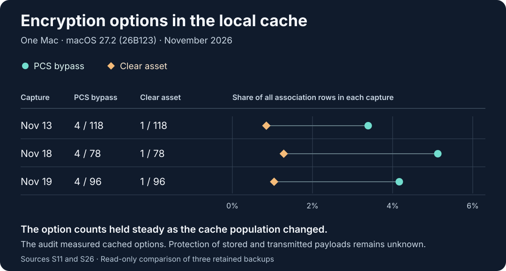
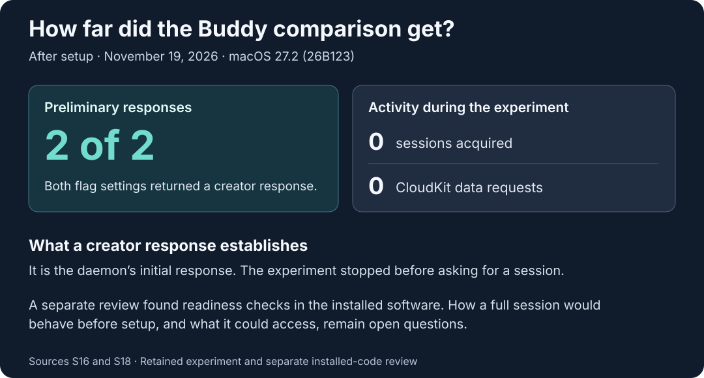

# Encryption options and Buddy access

The November 2026 audit recorded two encryption options in the original Mac’s local CloudKit metadata. A separate experiment measured how far a local client got during session setup. Both investigations used macOS 27.2 build `26B123`. They answer different questions about configuration and access.

## Encryption options in three snapshots

| Original Mac | Cached account associations | `bypassPCSEncryption=true` | `useClearAssetEncryption=true` |
| --- | ---: | ---: | ---: |
| Nov 13 | 118 | 4 | 1 |
| Nov 18 | 78 | 4 | 1 |
| Nov 19 | 96 | 4 | 1 |

Each cell counts association rows in one retained SQLite backup. The number of associations changed between captures, while the number carrying each option stayed the same. The audit did not follow the same asset across the three dates. [S11, S26]

Installed-code analysis found that Apple software uses these options in some asset-repair, key-syncing, and preferences operations. Apple’s published Security source also shows its own services requesting the PCS option. The public source and installed build were different versions. The retained evidence does not identify which code wrote any particular row. [S13, S14, S15] [Apple Security source revision used in the comparison](https://github.com/apple-oss-distributions/Security/tree/97c3a4296c1ea06b0fe1877a7e616aa84450b5b2)

Protected Cloud Storage (PCS), asset handling, and transport encryption concern different parts of a data transfer. To establish exposure, the audit would need evidence connecting an affected record or asset to its actual protection in storage or in transit. No such measurement was collected. The account’s Advanced Data Protection setting was also outside the scope of these observations. [Apple’s iCloud data security overview](https://support.apple.com/en-us/102651) · [Apple’s CloudKit encrypted-values documentation](https://developer.apple.com/documentation/cloudkit/encrypting-user-data)

## Buddy comparison after setup

The November 19 test used a local research helper after the Mac had completed setup. Its signature lacked the private Buddy entitlement. Both values of the tested configuration flag produced a preliminary session-setup response called an acquisition creator. The following counts describe only this experiment. [S16]

| Observation | Count |
| --- | ---: |
| Flag settings compared | 2 |
| Settings for which the daemon returned a creator | 2 of 2 |
| Sessions acquired | 0 |
| iCloud data requests made | 0 |

The experiment ended before session acquisition. The zero counts record where the researchers stopped. They cannot establish that the daemon would have allowed or denied a later request. Separately, the installed-code review found additional readiness checks. The research did not establish that either observed response reached those checks, or that a client could access a container during setup. [S16, S18]

## Which build was checked

On November 21, a read-only check found the same OS build and matching software-image UUIDs for CloudKit, CloudKitDaemon, and CloudCoreInternal as recorded in the earlier traces. These identifiers belong to the compiled Apple binaries. The comparison checks build provenance. It cannot establish byte-for-byte identity, signature validity, or execution during a historical request. [S19] [Sanitized build record](evidence/build-identity-2026-11-21.json)

The source index identifies the retained private reports and the three logical backups behind these counts. [Evidence and methods](evidence-and-methods.md#source-index)
